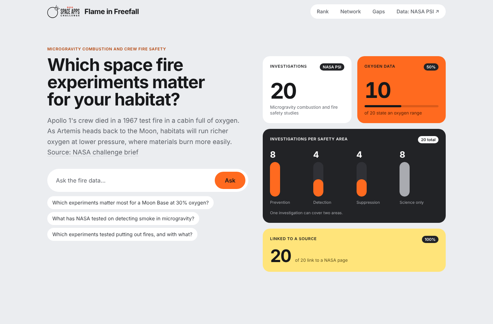
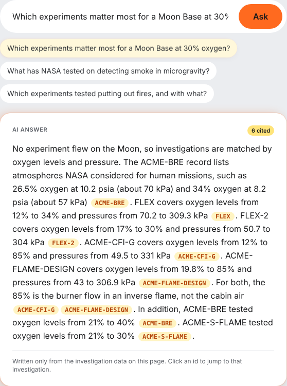
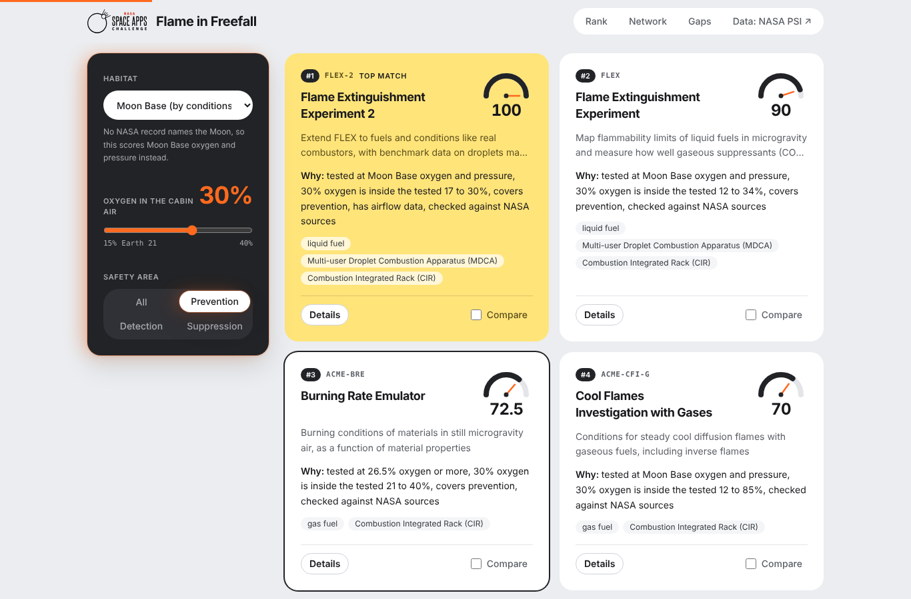
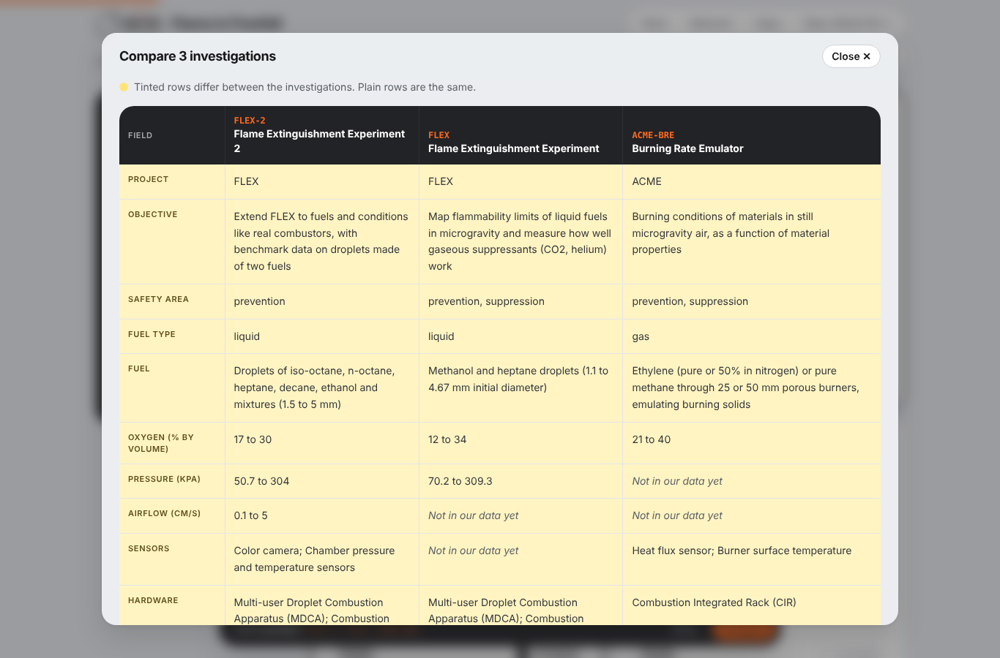
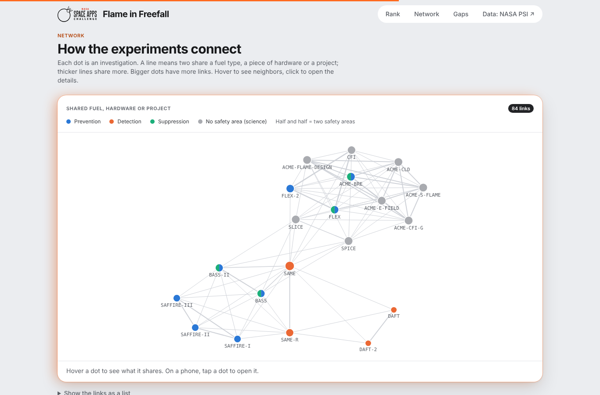
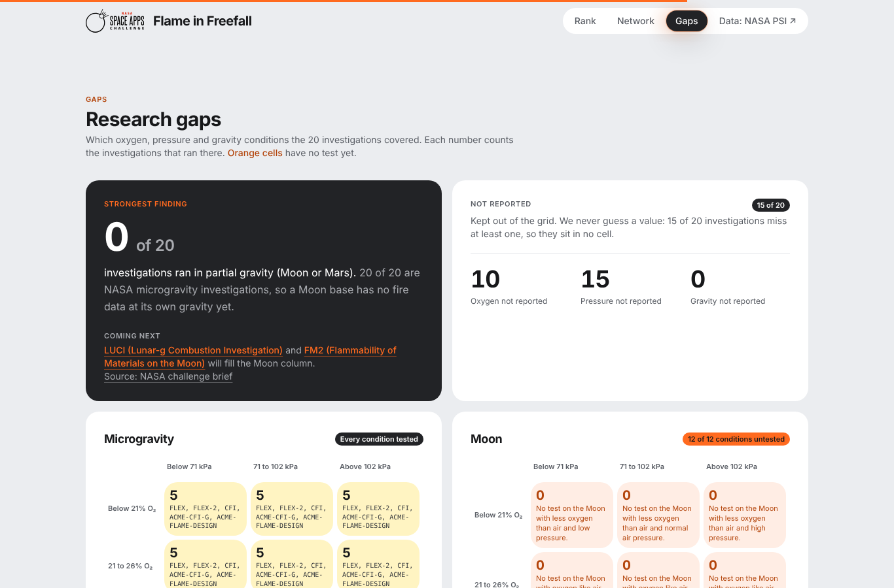

# Flame in Freefall

Find out in seconds which NASA microgravity fire experiments matter for a crew habitat, and why.

[](https://flame-in-freefall-five.vercel.app)
[](https://www.spaceappschallenge.org/2026/challenges/flame-in-freefall/)
[](https://nextjs.org)
[](https://www.typescriptlang.org)
[](LICENSE)

[](https://flame-in-freefall-five.vercel.app)

## The problem

NASA has studied fire in microgravity for decades, and the results are public in its Physical Science Informatics (PSI) database. But the amount of data "can be overwhelming. It can be hard to find, harder to compare, and harder yet to interpret" ([challenge brief](https://www.spaceappschallenge.org/2026/challenges/flame-in-freefall/)).

## What it does

**Ask.** Type a question in plain English. The answer cites the investigation behind each claim, and each citation jumps to that investigation.



**Rank.** Pick a habitat, a cabin oxygen level and a safety area (prevention, detection, suppression). The 20 investigations re-order with a score out of 100 and the reasons behind it.



**Compare.** Tick up to three investigations to see their fuels, oxygen, pressure, airflow, sensors and hardware side by side. Rows that differ are tinted.



**Network.** A graph of how the experiments connect through shared fuel type, hardware or project.



**Research gaps.** A grid of the oxygen, pressure and gravity conditions that were tested and the ones that were not. No investigation has run in partial gravity (Moon or Mars) yet.



## How it works

**Data pipeline**

```
NASA PSI records and DOIs
  -> data/investigations.csv        one row per investigation, taken from PSI records and their test tables, empty when PSI does not say
  -> npm run data                   scripts/build-data.mjs checks every column and writes investigations.json
  -> Next.js build on Vercel        pages are built from the JSON; checked example answers ship with the repo
  -> https://flame-in-freefall-five.vercel.app
```

To add or fix data, edit the CSV on github.com. Vercel rebuilds the site. See [docs/DATA_DAY.md](docs/DATA_DAY.md).

**Scoring** ([lib/score.ts](lib/score.ts)). A plain sum out of 100. Missing data scores 0.

| Points | Condition |
| --- | --- |
| 35 | Run for the chosen habitat. For Moon Base, no PSI record names the Moon, so it gets 17.5 for oxygen at 26.5% or more and 17.5 for pressure at 10.2 psia or less (atmospheres NASA considered for human missions, from the ACME-BRE record) |
| 25 | The chosen oxygen level is inside the tested range (12.5 if within 10 points of it) |
| 20 | Covers the chosen safety area |
| 10 | Has airflow data |
| 10 | Checked against NASA sources |

**How Ask stays grounded** ([lib/ask.ts](lib/ask.ts))

1. The model gets only the 20 records as its source and must cite a record id after each claim.
2. Every answer is checked in code before it is shown: each cited id must exist, and every number and name must appear in the record cited right after it. Answers that mention 85% oxygen must say it is burner flow, not cabin air.
3. A failed check gets one retry with the problems listed. Groq is tried first, then Gemini. If neither gives an answer that passes, the site shows an error instead of an unchecked answer.
4. Answers to the example questions are saved in `data/demo-answers.json` after passing the same checks. A build only asks the AI again when the data changes, and only replaces an answer with one that passes, so the demo does not depend on the AI being available.

## Data sources

All 20 investigations come from [NASA Physical Science Informatics (PSI)](https://science.nasa.gov/physical-sciences-informatics-psi/). The challenge text is from the [NASA Space Apps 2026 brief](https://www.spaceappschallenge.org/2026/challenges/flame-in-freefall/).

| Id | Investigation | PSI | DOI |
| --- | --- | --- | --- |
| BASS | Burning and Suppression of Solids | [PSI-26](https://psi.nasa.gov/physci/repo/data/investigations/PSI-26) | [10.60555/58h4-dy80](https://doi.org/10.60555/58h4-dy80) |
| BASS-II | Burning and Suppression of Solids II | [PSI-25](https://psi.nasa.gov/physci/repo/data/investigations/PSI-25) | [10.60555/4qc4-de67](https://doi.org/10.60555/4qc4-de67) |
| SAFFIRE-I | Spacecraft Fire Safety Experiment I | [PSI-98](https://psi.nasa.gov/physci/repo/data/investigations/PSI-98) | [10.60555/0t15-1z43](https://doi.org/10.60555/0t15-1z43) |
| SAFFIRE-II | Spacecraft Fire Experiment II | [PSI-99](https://psi.nasa.gov/physci/repo/data/investigations/PSI-99) | [10.60555/2chp-m469](https://doi.org/10.60555/2chp-m469) |
| SAFFIRE-III | Spacecraft Fire Experiment III | [PSI-100](https://psi.nasa.gov/physci/repo/data/investigations/PSI-100) | [10.60555/040q-4h36](https://doi.org/10.60555/040q-4h36) |
| SAME | Smoke and Aerosol Measurement Experiment | [PSI-102](https://psi.nasa.gov/physci/repo/data/investigations/PSI-102) | [10.60555/gd4k-8h62](https://doi.org/10.60555/gd4k-8h62) |
| SAME-R | Smoke Aerosol Measurement Experiment Reflight | [PSI-101](https://psi.nasa.gov/physci/repo/data/investigations/PSI-101) | [10.60555/2np7-jv14](https://doi.org/10.60555/2np7-jv14) |
| DAFT, DAFT-2 | Dust and Aerosol Measurement Feasibility Test 1 and 2 | [PSI-47](https://psi.nasa.gov/physci/repo/data/investigations/PSI-47) | [10.60555/ztgj-d202](https://doi.org/10.60555/ztgj-d202) |
| FLEX | Flame Extinguishment Experiment | [PSI-69](https://psi.nasa.gov/physci/repo/data/investigations/PSI-69) | [10.60555/mbq8-0451](https://doi.org/10.60555/mbq8-0451) |
| FLEX-2 | Flame Extinguishment Experiment 2 | [PSI-68](https://psi.nasa.gov/physci/repo/data/investigations/PSI-68) | [10.60555/byp8-h018](https://doi.org/10.60555/byp8-h018) |
| CFI | Cool Flames Investigation | [PSI-39](https://psi.nasa.gov/physci/repo/data/investigations/PSI-39) | [10.60555/m6pj-a914](https://doi.org/10.60555/m6pj-a914) |
| ACME-BRE | Burning Rate Emulator | [PSI-20](https://psi.nasa.gov/physci/repo/data/investigations/PSI-20) | [10.60555/vb93-3y72](https://doi.org/10.60555/vb93-3y72) |
| ACME-CFI-G | Cool Flames Investigation with Gases | [PSI-159](https://psi.nasa.gov/physci/repo/data/investigations/PSI-159) | [10.60555/cyt1-kh64](https://doi.org/10.60555/cyt1-kh64) |
| ACME-E-FIELD | Electric-Field Effects on Laminar Diffusion Flames | [PSI-22](https://psi.nasa.gov/physci/repo/data/investigations/PSI-22) | [10.60555/se5a-8c73](https://doi.org/10.60555/se5a-8c73) |
| SPICE | Smoke Point In Co-flow Experiment | [PSI-107](https://psi.nasa.gov/physci/repo/data/investigations/PSI-107) | [10.60555/9kbh-e962](https://doi.org/10.60555/9kbh-e962) |
| SLICE | Structure and Liftoff In Combustion Experiment | [PSI-106](https://psi.nasa.gov/physci/repo/data/investigations/PSI-106) | [10.60555/pm12-rg61](https://doi.org/10.60555/pm12-rg61) |
| ACME-FLAME-DESIGN | Flame Design | [PSI-10](https://psi.nasa.gov/physci/repo/data/investigations/PSI-10) | [10.60555/w4zy-bt45](https://doi.org/10.60555/w4zy-bt45) |
| ACME-CLD | Coflow Laminar Diffusion Flame | [PSI-21](https://psi.nasa.gov/physci/repo/data/investigations/PSI-21) | [10.60555/23e1-9950](https://doi.org/10.60555/23e1-9950) |
| ACME-S-FLAME | Structure and Response of Spherical Diffusion Flames | [PSI-23](https://psi.nasa.gov/physci/repo/data/investigations/PSI-23) | [10.60555/k57n-p030](https://doi.org/10.60555/k57n-p030) |

## Tech stack

[](https://skillicons.dev)

## Run locally

Needs Node.js 20 or newer.

```bash
git clone https://github.com/OSAMABASAM/flame_in_freefall.git
cd flame_in_freefall
npm install
cp .env.example .env
npm run dev
```

Open http://localhost:3000. Add free API keys to `.env` to use Ask with your own questions:

```
GROQ_API_KEY=     # https://console.groq.com
GEMINI_API_KEY=   # https://aistudio.google.com
```

Everything else (rank, compare, network, gaps) works without keys. Tests: `npm test` (unit) and `npm run test:demo` (full demo in a browser, with the dev server running).

## Limitations

- Ask runs on free AI tiers (Groq, then Gemini). When both are busy or over quota, typed questions fail with a message to try again; the example questions still answer from the cache.
- Only 10 of 20 investigations state an oxygen range and 5 state a pressure range in PSI. Missing values are left empty and score 0. They are never guessed.
- No investigation in PSI ran in partial gravity. Moon Base is scored by the oxygen and pressure NASA considered for human missions, not by lunar gravity data.
- The dataset covers 20 investigations taken from PSI records. It is a snapshot, not a live feed from PSI.

## License

[MIT](LICENSE) © 2026 Osama Saleh
